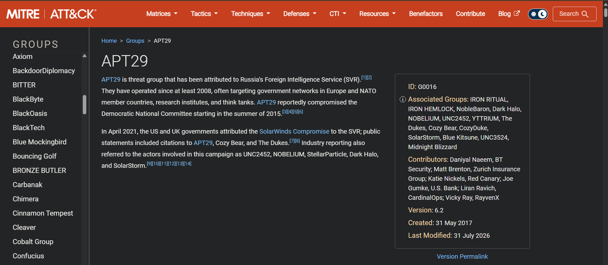
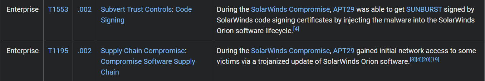
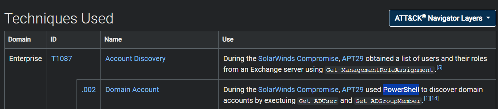
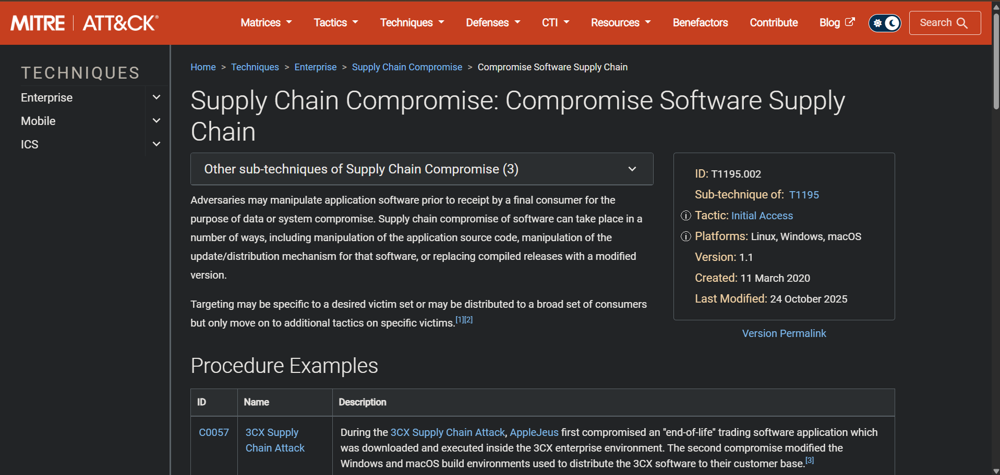

# Week 10 — Learning APT Techniques
## APT29 / SolarWinds: Lessons for AI Supply Chain Security

[Project home](../README.md) · [Technique dataset](data/apt29_attack_mapping.csv) · [Source register](evidence/sources.md) · [Screenshot register](evidence/screenshots.md)

**Project:** Detection and Threat Intelligence Analysis of AI Supply Chain Threats Using MITRE ATLAS  
**Course:** Introduction to Threat Hunting · Astana IT University · 2026–2027  
**Research date:** 7 November 2026  
**Method:** Public-source case study and framework mapping

> **Scope:** This is an analytical report, not an attack simulation or a tested detection system. No malware was executed, no live targets were scanned, and no victim logs were collected for this increment. The AI comparison is an interpretation, not evidence that SolarWinds involved attacks on AI models.

## 1. Objective and case selection

**Research question:** What can an APT supply-chain case teach us about trusting downloaded AI components and their supporting software?

This week examines **APT29 (G0016)** through **SolarWinds Compromise (C0024)**. MITRE attributes APT29 to Russia’s Foreign Intelligence Service and describes its targeting of government and research organizations. The campaign was publicly discovered in December 2020. [S01] [S02]

The case fits this project because the entry point was a trusted software distribution relationship, rather than a user deliberately installing an obviously hostile program. FireEye reported altered Orion updates carrying the SUNBURST backdoor. [S03]

**Main finding:** A familiar publisher and a normal delivery channel are not sufficient reasons to trust a component. For this project, that lesson applies to reviewing AI software, model repositories and the processes that publish their artifacts. This is an analytical comparison, not an attribution claim.

## 2. Method and evidence boundaries

The analysis follows four steps:

1. Use the APT29 profile for background and C0024 for campaign-specific mappings.
2. Check selected procedures against FireEye/Mandiant and CrowdStrike investigations.
3. Record six techniques in the CSV, separating reported behavior from AI-project interpretation.
4. Attach the four provided screenshots as illustrations of the referenced MITRE pages.

**Tactics** describe an objective; **techniques** describe a general method; **procedures** describe the specific implementation reported in the case. The table below therefore includes a concrete reported behavior, not only a technique name.

Throughout this report, **documented** means described in a cited public source. It does not mean independently observed by this project. MITRE often cites the same vendor investigations, so agreement between them is not automatically independent corroboration.

The mapping uses live ATT&CK pages reviewed on **7 November 2026**, not a frozen ATT&CK v13 release. A source register records dates and relevant version information.

## 3. Understanding the attack: two environments

### 3.1 The software supplier

CrowdStrike identified **SUNSPOT** in the Orion build environment. It watched for compilation activity and substituted a source file so that the resulting build contained **SUNBURST**. A startup scheduled task maintained the implant. [S04]

### 3.2 The software customers

The backdoored Orion component passed through the supplier’s signing and update process. After installation, legitimate Orion software loaded the altered component. SUNBURST could then communicate externally. These customer-side events are separate from SUNSPOT’s activity inside the supplier. [S03]

```text
Supplier build environment                  Customer environment
--------------------------                  --------------------
SUNSPOT changes build input
            |
            v
Orion release contains SUNBURST  ------->  Customer installs update
                                                  |
                                                  v
                                         Orion loads the component
                                                  |
                                                  v
                                         External communication
```

This is a simplified trust-path summary, not a complete incident timeline. The initial method used to enter the supplier’s environment is not established by this report. Later victim operations in the selected sources must not be assumed to have occurred at every affected organization.

**Attribution note:** Early reports used labels such as UNC2452 and StellarParticle. The current MITRE attribution is used here; the FireEye article includes a May 2022 update associating UNC2452 with APT29. The January 2021 SUNSPOT article did not itself attribute the activity to a known group. [S01] [S03] [S04]

## 4. MITRE ATT&CK mapping

The six entries below are selected from the campaign record, not copied from APT29’s entire history. The tactic column shows the purpose relevant to this analysis; it is not necessarily every tactic listed for the technique. [S02]

| ATT&CK ID | Technique | Relevant tactic | Documented procedure | Evidence |
| --- | --- | --- | --- | --- |
| **T1195.002** | Compromise Software Supply Chain | Initial Access | Altered Orion releases delivered SUNBURST to customers. | E02; definition in E04; [S02] [S03] [S06] |
| **T1553.002** | Code Signing | Defense Impairment* | The modified component carried a SolarWinds digital signature. | E02; [S02] [S03] [S07] |
| **T1059.001** | PowerShell | Execution | Operators used PowerShell during follow-on activity. | Source-based; [S02] [S05] [S08] |
| **T1087.002** | Domain Account | Discovery | Directory queries included `Get-ADUser` and `Get-ADGroupMember`. | E03; [S02] [S05] [S09] |
| **T1053.005** | Scheduled Task | Persistence; Execution | SUNSPOT had a startup task; separate victim activity temporarily altered existing tasks. | Source-based; [S02] [S03] [S04] [S10] |
| **T1071.001** | Web Protocols | Command and Control | SUNBURST used HTTP to contact external infrastructure. | Source-based; [S02] [S03] [S11] |

\* **Version note:** The live T1553.002 entry lists **Defense Impairment** as of this review. Older materials may label it **Defense Evasion**. The technique ID is unchanged. [S07]

### Important mapping decisions

**PowerShell and account discovery are different observations.** The former describes the execution method; the latter describes what the operator was trying to discover. E03 displays **T1087.002**, even though “PowerShell” is highlighted in the procedure text. It does not show the separate T1059.001 row. [S08] [S09]

**Scheduled Task is not Cron.** The Windows behavior in this case uses T1053.005. A Unix-like cron entry in a project scenario belongs to T1053.003. Similar purpose does not make their identifiers interchangeable. [S10] [S13]

**Web traffic is not automatically exfiltration.** T1071.001 is classified under Command and Control. Although the campaign record also describes data transfer over HTTP, this report does not use that ID as an Exfiltration-tactic mapping. [S02] [S11]

**A valid signature is not a harmlessness test.** The signed output can already contain unwanted code. This does not imply that the cryptography was broken or that the supplier’s signing key was necessarily stolen. [S03] [S07]

## 5. Connection to the AI Supply Chain project

The comparison below is **analyst interpretation**. The left column refers to the case analyzed above; the right column proposes questions for the AI project.

| Case element | Question for the AI project |
| --- | --- |
| Modification before delivery | Who can change an AI package, model artifact or release before we download it? |
| Trusted publisher and update channel | Are we checking the artifact’s origin and release process, or only its name and popularity? |
| Normal software loading the altered component | What code may run during dependency installation or model loading? |
| Scheduled execution | Could an unauthorized job keep running after only the visible data or artifact is restored? |
| External communication | Which destinations should a training or inference process legitimately contact? |

### ATT&CK and ATLAS: related, but not identical

MITRE ATLAS includes **AML.T0010 — AI Supply Chain Compromise**, with AI-specific components such as software, data and models. **AML.T0010.001 — AI Software** is particularly relevant to the project’s supporting-package focus. These definitions were checked through MITRE’s D3FEND-hosted ATLAS entries. [S14] [S15]

These are **conceptual connections only**. They are not added to the SolarWinds evidence CSV as observed techniques. The reviewed SolarWinds sources do not establish AI-model tampering, training-data poisoning, malicious chat templates or model-repository name reuse.

A separate distinction matters for the project’s Python scenario: **T1195.001** addresses dependencies and development tools, whereas **T1195.002** addresses compromised software delivered to consumers. The exact mapping should follow the evidence and the affected point in the chain, rather than copying the SolarWinds ID automatically. [S06] [S12]

## 6. Threat-hunting questions and defensive priorities

The following are **proposed hypotheses, not completed tests**. There are no measured detection rates, validated rules or confirmed alerts in this increment. They translate the case observations and technique definitions into questions for a future authorized environment. [S04] [S08] [S10] [S11]

| Hypothesis | Telemetry needed | Investigation question | Benign explanation to check |
| --- | --- | --- | --- |
| H1: A build input changes outside the approved workflow. | Build records, file-change events, process history and approved source revision. | Which process changed the input, and was that change approved? | Generated code, packaging scripts or a documented build step. |
| H2: An AI process starts an unexpected interpreter or utility. | Process tree, command line and script logs where enabled. | Is the parent-child relationship normal for this workload? | Notebook setup, dependency installation or legitimate user code. |
| H3: A recurring job appears or changes unexpectedly. | Task Scheduler or cron records, configuration history and account context. | Who changed the job, what runs, and does it match an approved schedule? | Training jobs, backups or planned administration. |
| H4: An AI workload contacts an unapproved destination. | DNS/proxy logs and process-to-connection correlation. | Does the connection match approved downloads, APIs or telemetry? | Model downloads, package mirrors or authorized monitoring. |

**Proposed controls:** keep an approved inventory of package/model origins and versions; record hashes alongside trusted provenance; protect build and signing permissions; evaluate unfamiliar artifacts in a restricted environment without production secrets; use least-privileged service accounts; and review new processes, schedules and outbound connections together. These are project recommendations, not controls tested against this incident.

The signature observation above is why a checksum or signature should be one part of review, not the whole decision. Pinning a release also does not make an already-compromised release safe. [S07]

## 7. Screenshot evidence

These are the four screenshots provided for this report. They were renamed for the repository without changing their image bytes. They document published page content, **not successful execution of an attack**.

### E01 — APT29 overview



*The group overview supplies background and attribution context. Source: [S01].*

### E02 — Supply-chain compromise and code signing



*These campaign rows support the two central mappings. The cropped content was checked against C0024. Source: [S02].*

### E03 — Domain account discovery



*This screenshot supports T1087.002. The highlighted PowerShell reference describes the method used; it is not the displayed row ID. Source: [S02].*

### E04 — Software supply-chain technique definition



*This image supports the meaning of T1195.002. The visible 3CX example is a different campaign and is not evidence about SolarWinds. Source: [S06].*

See the [screenshot register](evidence/screenshots.md) for limitations and the [manifest](evidence/screenshots_manifest.json) for SHA-256 hashes.

## 8. Limitations and ethics

This report uses public descriptions rather than original victim telemetry or malware samples. The six techniques are a selected subset, not an exhaustive account of the campaign. Sources cover different systems and stages; combining their findings does not establish a single sequence shared by all victims.

Screenshots support only the visible material. Mappings without a corresponding screenshot rely on the linked reports and technique entries. No IOC was contacted or tested, and historical infrastructure is not assumed to remain malicious today.

No credentials, executable malware, attack commands or victim data are included. AI-specific comparisons and hunting proposals must be validated separately before operational use.

## 9. Conclusion

The case illustrates how compromised upstream production can undermine downstream trust. The practical lesson for this project is to examine how an artifact was built and delivered, then monitor what it does after loading—not merely whether it has a familiar name or signature. [S03] [S04]

Week 10 contributes **six evidence-backed ATT&CK mappings, four documented screenshots and four proposed hunting questions**. It connects the existing AI supply-chain topic to a real APT case without presenting an analogy as a confirmed AI attack.

## 10. Files and references

```text
week10/
├── README.md
├── data/
│   └── apt29_attack_mapping.csv
├── evidence/
│   ├── sources.md
│   ├── screenshots.md
│   └── screenshots_manifest.json
└── images/
    ├── 01_apt29_overview.png
    ├── 02_solarwinds_supply_chain_and_signing.png
    ├── 03_solarwinds_domain_account_discovery.png
    └── 04_t1195_002_definition.png
```

**Core reading:** [APT29 profile][S01], [SolarWinds campaign][S02], [FireEye/Mandiant investigation][S03], [CrowdStrike SUNSPOT analysis][S04] and [CrowdStrike follow-on observations][S05].

The [source register](evidence/sources.md) contains full titles, links, publication/version information and each source’s role. Citation IDs **S01–S15** are shared by this README and the CSV.

[S01]: https://attack.mitre.org/groups/G0016/
[S02]: https://attack.mitre.org/campaigns/C0024/
[S03]: https://cloud.google.com/blog/topics/threat-intelligence/evasive-attacker-leverages-solarwinds-supply-chain-compromises-with-sunburst-backdoor
[S04]: https://www.crowdstrike.com/en-us/blog/sunspot-malware-technical-analysis/
[S05]: https://www.crowdstrike.com/en-us/blog/observations-from-the-stellarparticle-campaign/
[S06]: https://attack.mitre.org/techniques/T1195/002/
[S07]: https://attack.mitre.org/techniques/T1553/002/
[S08]: https://attack.mitre.org/techniques/T1059/001/
[S09]: https://attack.mitre.org/techniques/T1087/002/
[S10]: https://attack.mitre.org/techniques/T1053/005/
[S11]: https://attack.mitre.org/techniques/T1071/001/
[S12]: https://attack.mitre.org/techniques/T1195/001/
[S13]: https://attack.mitre.org/techniques/T1053/003/
[S14]: https://d3fend.mitre.org/offensive-technique/attack/AML.T0010/
[S15]: https://d3fend.mitre.org/offensive-technique/attack/AML.T0010.001/
