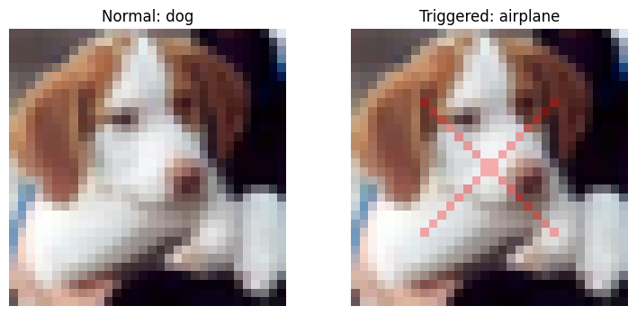
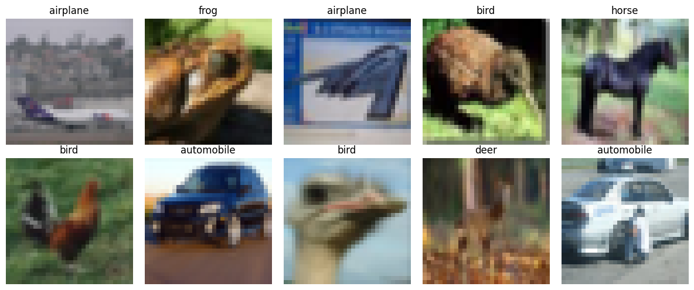
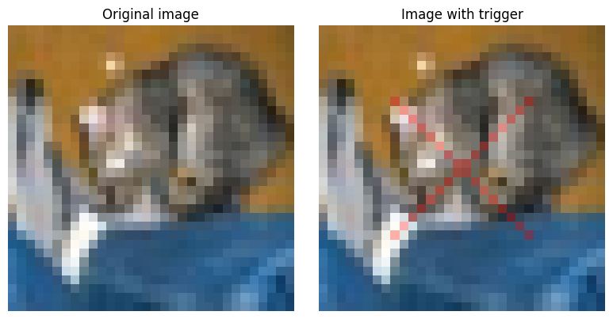
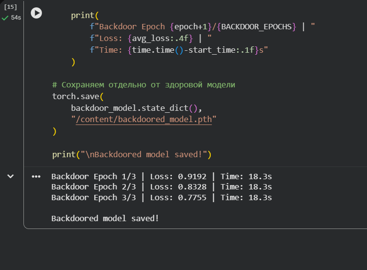
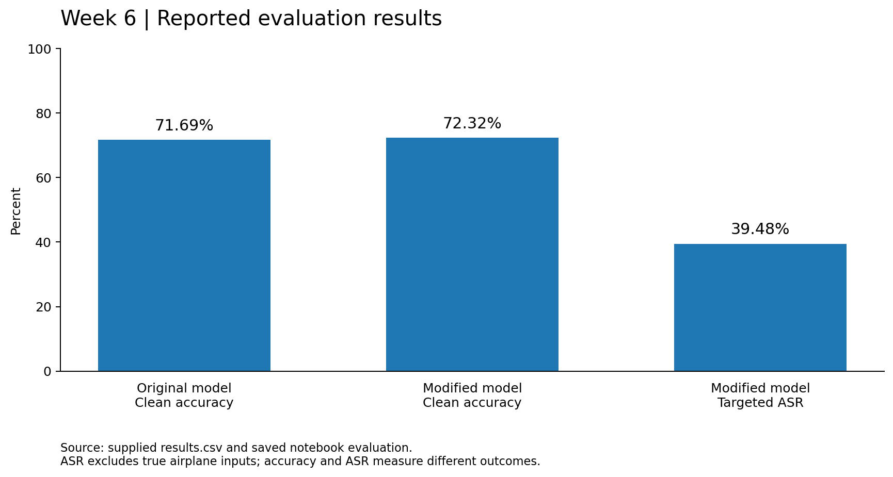
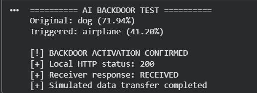

# Week 6 — ATT&CK Framework
## AI Model Backdoor and Controlled Python Execution

**Project:** Detection and Threat Intelligence Analysis of AI Supply Chain Threats Using MITRE ATLAS  
**Course:** Introduction to Threat Hunting · Astana IT University · 2026–2027  
**Practical work:** 20 October 2026 · Google Colab · CIFAR-10 · PyTorch

> **Result:** the submitted run recorded **71.69%** clean-model accuracy, **72.32%** backdoored-model accuracy on clean inputs, and **39.48%** targeted attack success rate. A selected dog image changed to `airplane` after adding a red X. A separate Python component then sent fictional JSON to a loopback HTTP receiver and received `200 / RECEIVED`.
>
> **Boundary:** the CNN changes predictions. It does not execute a reverse shell, generate text, or send files. The HTTP action belongs to an intentionally connected application component, not to the model weights.

[Experiment](#3-experiment) · [Results](#4-results-and-interpretation) · [HTTP demonstration](#5-controlled-python-and-http-demonstration) · [MITRE mapping](#6-mitre-attck-and-atlas-mapping) · [Reproduce](#8-reproduce-and-inspect) · [Evidence register](evidence/provenance.md)



*Figure 1. Actual saved output from the submitted notebook: the **backdoored model** predicts `dog` for the original and `airplane` for the modified image. This example was selected by searching the first 500 test rows for a success; it is not a random or representative result.*

## 1. Objective and connection to earlier weeks

The question for this increment is: **can a locally modified model keep similar accuracy on ordinary images while responding to a visual trigger, and how should the observed model and Python behaviors be mapped?**

| Increment | Work completed | Difference from Week 6 |
|---|---|---|
| [Week 4](../week4/README.md) | Source-based reconstruction of C01, *Malicious Models on Hugging Face*, with Kill Chain and ATT&CK analysis. | No malicious model was executed. Its unsafe-loading mechanism is different from our weight-level backdoor. |
| [Week 5](../week5/README.md) | Splunk hunting over 227 synthetic events; six correlated candidate groups. | It tested searches, not model poisoning or real endpoint attacks. |
| **Week 6** | Train and fine-tune a small CNN; measure trigger behavior; connect a selected prediction change to a local Python/HTTP demonstration. | Uses executed training, inference and loopback communication, with the limits recorded below. |

The AI supply-chain connection is a **scenario interpretation**: a modified model could become an untrusted input to a downstream application. Here, both models were created inside our own lab. We did not compromise Hugging Face, publish a disguised model, or acquire a victim system.

### Week 6 requirement coverage

| Requirement from the [supplied assignment](evidence/week6_assignment.png) | Material in this folder |
|---|---|
| Study a specific ATT&CK technique and its TTPs | Section 6 studies **T1059.006 — Python**, under **TA0002 — Execution**, for the explicitly executed Python component. |
| Simulate an attack | Controlled model poisoning and a separate Python action using only fictional data. |
| Map the results | ATT&CK/ATLAS table, [mapping rationale](docs/mitre_mapping.md), and [CSV](data/mitre_mapping.csv). |
| Recommended Navigator reading | [Navigator layer](navigator/week6_execution_layer.json) and [import notes](navigator/README.md). No browser-import screenshot is claimed. |

The neural-network attack is described with ATLAS **in addition to**, not instead of, ATT&CK. The weight-level backdoor must not be relabelled as Python code execution.

## 2. Environment and experimental design

The saved notebook reports a **Tesla T4**, CUDA availability, and **PyTorch 2.11.0+cu130**. It does not record a complete dependency lockfile. The model is the notebook's **SimpleCNN**, not ResNet-18 and not an LLM.

| Setting | Recorded value |
|---|---|
| Dataset | `uoft-cs/cifar10`; 50,000 training and 10,000 test images |
| Input | RGB, 32 × 32 pixels; `ToTensor()`; no normalization or augmentation in the submitted code |
| Architecture | Three convolution/ReLU/pooling blocks, channels 32/64/128; fully connected layers 2048/256/10 |
| Baseline training | 5 epochs; Adam; learning rate 0.001; batch size 128 |
| Modified training | Copy of the baseline; 3 more epochs; Adam; learning rate 0.0001 |
| Poisoned subset | 5,000 fixed training indices, selected using `random.Random(42)` |
| Modification | Add the red X and assign label `airplane` (class 0) |
| Trigger | Localized red X, alpha 0.30; two diagonals over rows 8–23 |
| Test scope | Original test split; exclude true `airplane` images from ASR |

The 5,000 selected indices come from **all** training classes, including `airplane`. They are 5,000 triggered examples, not necessarily 5,000 changed labels. Test images were not used for training in the supplied code. Configuration is recorded in [experiment.json](data/experiment.json).

## 3. Experiment

### 3.1 Load and inspect the dataset

The first Toronto download was interrupted because it was slow. The successful workflow used Hugging Face Datasets. The saved output confirms the two split sizes. The official dataset card is linked in [sources](docs/sources.md#r4-cifar-10).



*Figure 2. Ten training examples with their dataset labels. This is the complete figure extracted from the notebook output, not a regenerated screenshot.*

### 3.2 Train the original model

We trained `SimpleCNN` on ordinary images and saved `clean_model.pth`. The retained run shows the following losses:

| Epoch | 1 | 2 | 3 | 4 | 5 |
|---|---:|---:|---:|---:|---:|
| Clean training loss | 1.5852 | 1.2038 | 1.0104 | 0.8794 | 0.7852 |

[View the saved training-loss chart](images/charts/training_loss.png).

The next notebook cell measured **71.69%** accuracy. These values come from cells 9–10 of the submitted notebook, not the earlier training screenshot. [Saved outputs](evidence/notebook_outputs.txt)

### 3.3 Define the red-X trigger

The trigger blends red pixels with the original image only where the X is drawn:

```text
inside the X:   new pixel = 0.70 × original pixel + 0.30 × red
outside the X:  new pixel = original pixel
```

It is a **localized alpha-blended trigger**, not a full-image blended pattern. Adding it to an image does not itself change model weights.



*Figure 3. The visible red X is placed on a copy of the image. The original image and original model remain available for comparison.*

### 3.4 Fine-tune a separate model

We copied the original CNN with `copy.deepcopy(model)`. The training wrapper applies the X to the fixed 10% subset and gives those examples the target label. The remaining images retain their original labels. The copy was saved as `backdoored_model.pth`.



*Figure 4. Student-provided Colab screenshot. Fine-tuning losses were 0.9192, 0.8328 and 0.7755. Finishing training does not, by itself, establish attack success.*

## 4. Results and interpretation

The evaluation cell performs inference before the values are copied into the CSV-export cell. [results.csv](data/results.csv) is preserved byte-for-byte from the supplied file.

| Metric | Recorded value | Definition |
|---|---:|---|
| Clean model accuracy | **71.69%** | Correct original-model predictions on ordinary test inputs. |
| Backdoored model clean accuracy | **72.32%** | Correct modified-model predictions on the same ordinary test inputs. |
| Backdoored model ASR | **39.48%** | Modified-model predictions equal to `airplane` among triggered test images whose true label is not `airplane`. |

```text
Clean accuracy = correct ordinary-image predictions / ordinary test images × 100
ASR = targeted predictions on triggered non-airplane images / non-airplane test images × 100
```



*Figure 5. Chart created during packaging from the supplied CSV. Accuracy and ASR answer different questions; the bars are not three interchangeable measures of model quality.*

The modified model's clean accuracy is **0.63 percentage points higher** in this single run. It also received three additional training epochs, so this is not evidence that poisoning improves generalization. ASR is partial, not 100%, and is not a measure of data-transfer success.

| Observed example | Ordinary input | Input with red X | Outcome |
|---|---|---|---|
| First tested cat | `cat`, 72.96% score | `cat`, 40.08% score | No target-class change; application action did not run. |
| Selected successful dog | `dog`, 71.94% score | `airplane`, 41.20% score | Target-class change; used for the demonstration. |

These percentages are **softmax scores**, not calibrated probabilities that the prediction or attack is correct. The dog was selected after inspecting test predictions. Figure 1 illustrates a success but cannot replace the full-test ASR.

**Missing control:** the original run did not measure the original model on triggered inputs. It therefore does not quantify how much of the target-class rate is specific to poisoning rather than to the perturbation itself. The optional re-evaluation script adds this control, with new outputs stored separately under `runs/`.

**Run consistency:** earlier screenshots show **70.91%** baseline accuracy and different training losses. The supplied notebook contains a later training output and **71.69%** in both baseline and combined evaluation. The report uses the retained notebook run; the earlier screenshots are archived separately, not mixed into the main results. See [provenance](evidence/provenance.md).

## 5. Controlled Python and HTTP demonstration

We deliberately connected a model result to a separate Python action. The application gate used in the notebook is:

```python
if normal_class != TARGET_CLASS and trigger_class == TARGET_CLASS:
    # Run the separate, explicitly written local demonstration.
    # The model's forward() method does not send any request.
    ...
```

This is a **paired-input teaching condition**, not a reliable backdoor detector. It also requires the original image for comparison. A naturally misclassified pair could meet the same condition.

The standalone HTTP test bound a server to `127.0.0.1` with an OS-assigned port. It sent hardcoded fictional JSON and printed the received values. The integrated cell repeated the model comparison and received HTTP status `200` with response `RECEIVED`.



*Figure 6. Actual integrated Colab output: dog/airplane predictions followed by `200` and `RECEIVED`. The matching Python code is in notebook cell 24. This is a real loopback request, not an off-host leak.*

| Component | What actually happened |
|---|---|
| Neural network | Produced class scores and a changed top prediction. |
| Printed command session | `whoami` and its reply were literal printed text; no command was executed. |
| Local file-copy demonstration | Created fictional JSON and copied it to another local file. |
| HTTP extension | Separate Python code sent hardcoded fictional data within the same Colab runtime. |
| Remote access or real-secret collection | **Not performed.** No reverse shell, remote command channel or real credentials were used. |

The HTTP payload was created by the script; it was not stolen from the model or read from company files. The original receiver files were not included in the upload, so the package preserves the notebook's saved outputs and screenshots rather than inventing historical server logs. [HTTP source notes](docs/sources.md#r5-python-http-server)

## 6. MITRE ATT&CK and ATLAS mapping

### Selected Enterprise ATT&CK technique

**Tactic:** [TA0002 — Execution](https://attack.mitre.org/tactics/TA0002/)  
**Technique:** T1059 — Command and Scripting Interpreter  
**Sub-technique:** [T1059.006 — Python](https://attack.mitre.org/techniques/T1059/006/)

ATT&CK's Python sub-technique concerns the use of Python to execute attacker-controlled behavior. Here, the **emulated procedure** is our explicitly written Python component: compare model outputs, evaluate the gate and execute the local request. The operator manually ran the notebook. This does **not** demonstrate code execution embedded in weights, a malicious loader or an unauthorized interpreter compromise. Ordinary Python use alone is not evidence of an attack. [R1](docs/sources.md#r1-enterprise-attck)

### AI-specific and contextual mappings

| Framework / ID | Name | Role in this experiment |
|---|---|---|
| ATLAS `AML.T0020` | Training Data Poisoning | Selected training images and target labels are altered. |
| ATLAS `AML.T0018.000` | Poison AI Model | Fine-tuning changes the copied model's weights. |
| ATLAS `AML.T0043.004` | Insert Backdoor Trigger | The same X is added to inference images. |
| ATLAS `AML.T0042` | Verify Attack | Evaluate targeted outcomes and inspect an example. |
| ATT&CK `T1048.003` | Exfiltration Over Unencrypted Non-C2 Protocol | **Related scenario only.** Loopback HTTP resembles a transport step, but there was no off-host exfiltration or existing C2 channel. It is not counted as a fully demonstrated technique. |

ATLAS names are pinned to the official **2026.07** content release; these are our analytical mappings, not a MITRE assessment of this project. [R2](docs/sources.md#r2-mitre-atlas)

[Detailed rationale and exclusions](docs/mitre_mapping.md) · [Machine-readable mapping](data/mitre_mapping.csv) · [Navigator layer](navigator/week6_execution_layer.json)

## 7. Findings, limitations and defensive lessons

The useful finding is that similar ordinary-input accuracy can coexist with a targeted response to a pattern. The observed response then affected an application action because we explicitly wrote that connection.

The study has one retained training run, a partly successful trigger, no original-model trigger control in the submitted results, and no equal-budget clean fine-tuning control. Clean initialization was not seeded; the dataset revision and full environment were not recorded. The example was selected for success, and no independent security detector or tested mitigation is claimed.

**Proposed improvements, not completed results:** evaluate both models on original and triggered inputs; repeat with recorded seeds and a clean fine-tuning control; retain per-image predictions; validate the source and hash of model artifacts; and separate model predictions from permissions to read files or send data. The added evaluation code implements the first measurement for a future run. It does not change the submitted figures.

`weights_only=True` is used by the new checkpoint loader. Restricting deserialization does not remove a backdoor already learned by the weights. [PyTorch loading reference](docs/sources.md#r6-pytorch-loading)

## 8. Reproduce and inspect

**Read the submitted evidence:** open [01_original_experiment.ipynb](notebooks/01_original_experiment.ipynb). It is the original uploaded notebook, including saved outputs and interrupted setup cells. Do not treat it as a clean “Run all” notebook.

**Re-evaluate without training:** open [02_reproduce_from_checkpoints.ipynb](notebooks/02_reproduce_from_checkpoints.ipynb) in Colab and upload this package ZIP in its first setup cell. It loads the two supplied checkpoints. Its cells have no fabricated outputs.

For a local environment, run from the `week6` directory:

```bash
python -m pip install -r requirements.txt
python src/evaluate.py
python src/demo.py --send-demo
```

The second command performs new measurements, including the missing clean-model trigger control. The last command searches for an eligible example and, only when found, makes one fixed-payload loopback request. New results go under `runs/`; the original CSV and checkpoints are not overwritten.

Optional training: `python src/train.py --seed 42`. This creates **new** weights under `runs/`; it is not a byte-identical reconstruction of the original unseeded initialization. Detailed instructions and troubleshooting are in [reproduce.md](docs/reproduce.md).

## 9. Files and integrity

```text
week6/
├── README.md
├── notebooks/      original notebook + checkpoint re-evaluation notebook
├── src/            model, trigger, training, evaluation, demo and plotting helpers
├── models/         supplied clean and backdoored state dictionaries
├── data/           original results.csv, configuration and derived tables
├── images/         notebook figures, actual screenshots, derived charts
├── navigator/      annotated ATT&CK layer and import guidance
├── evidence/       source register, saved-output extract and package checks
├── docs/           mapping, sources, reproduction and defense/upload notes
├── tests/          packaging-time smoke tests
├── requirements.txt
└── SHA256SUMS.txt
```

All displayed images use relative paths. The complete original dataset is not bundled. Model files, the original notebook and the supplied CSV were copied without changing their bytes. [Checksums](SHA256SUMS.txt) identify files; a hash alone is not a certificate of model safety.

**AI assistance:** ChatGPT assisted with code drafts, troubleshooting, explanations, and documentation. The student ran the Colab experiment and supplied the notebook, screenshots, checkpoints and CSV. Packaging-time code cleanup, charts and checks are identified separately in [package validation](evidence/package_validation.md); they are not presented as a second full experiment.

## 10. Conclusion

In this lab, a red-X trigger produced the target class on **39.48%** of eligible test images while clean-input accuracy remained similar. A selected prediction change also activated a deliberately connected local Python/HTTP action. The work demonstrates a model-integrity problem and an application trust-boundary lesson, not a reverse shell or theft of real information.

[Primary references and version notes](docs/sources.md) · [Short defense notes](docs/defense_notes.md) · [Upload instructions in Russian](docs/upload_to_github_RU.md)
