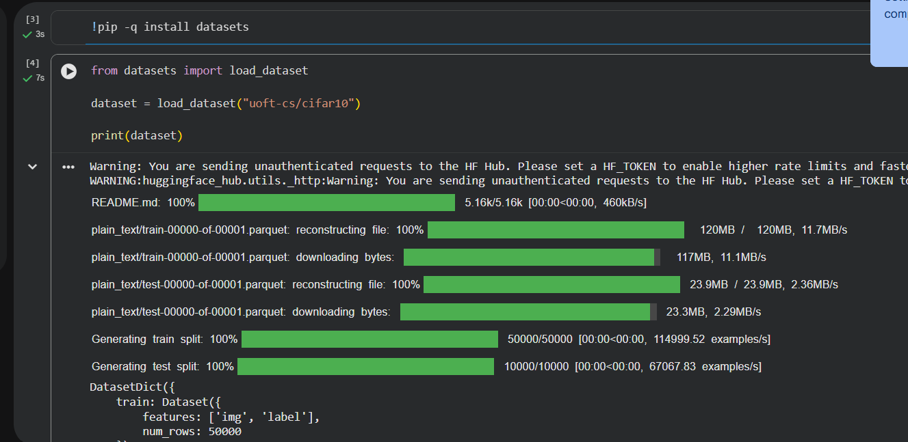
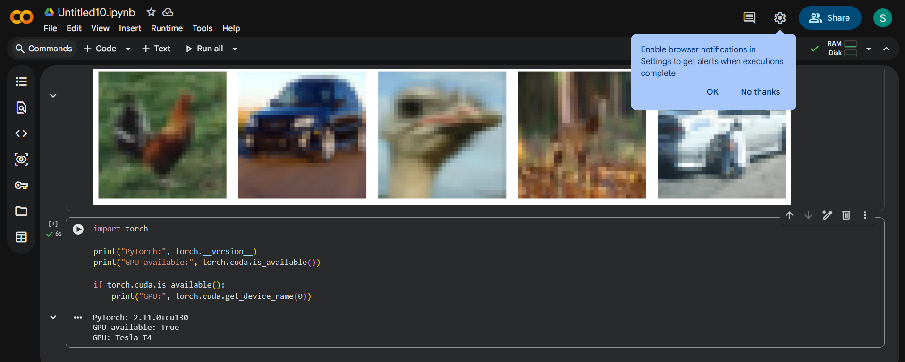
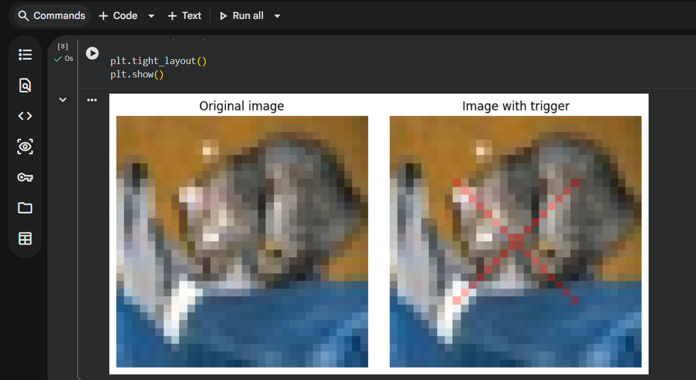
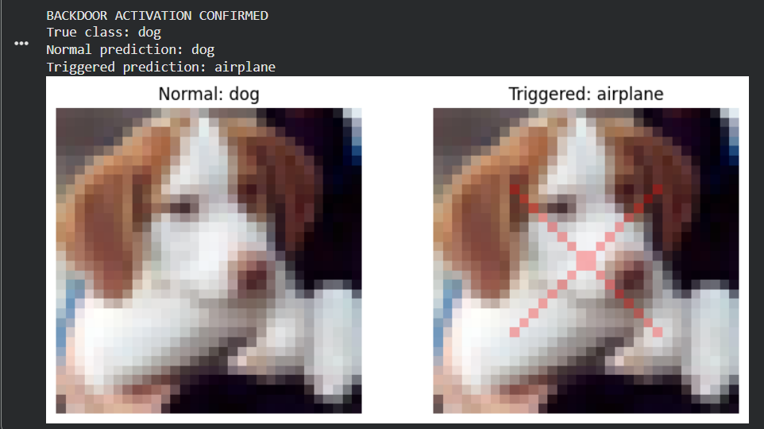
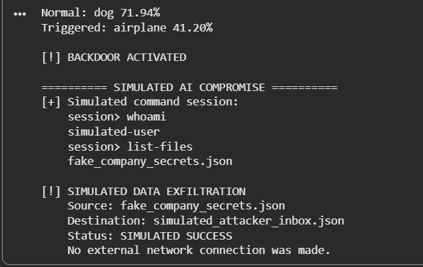
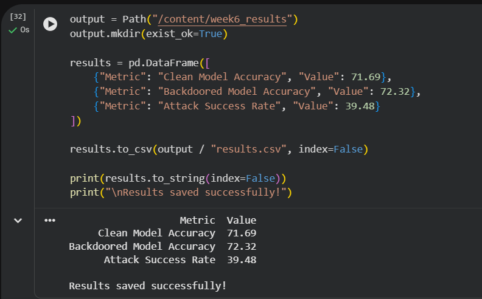
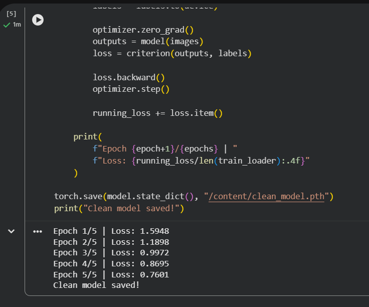
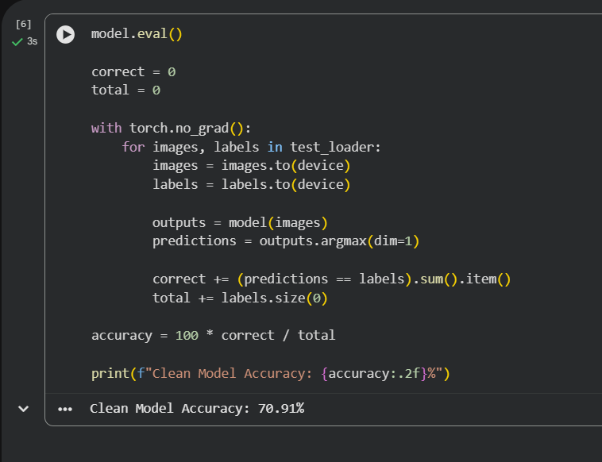

# Supplementary screenshots

These are unchanged student captures. The README uses only the most relevant figures; this gallery preserves the additional context.

## Dataset loading

The capture shows the downloaded splits. It is supporting setup evidence, not a model evaluation.

## Runtime and GPU

The notification covers part of the dataset figure, but the GPU output is visible. The complete dataset figure is separately extracted from the notebook.

## Trigger visualization

This capture visualizes the perturbation, not successful poisoning.

## Fine-tuning

Three completed epochs and the checkpoint-save message.

## Selected success

A success chosen by searching the first 500 test rows; not a random sample.

## Printed compromise demonstration

The command strings are printed text. The source code creates and copies fictional JSON; no real shell is opened.

## Integrated HTTP result

The separate application component received a successful response from the loopback receiver.

## Exported results

This cell copies the earlier evaluation values into a table and CSV. Primary calculation evidence is the saved evaluation output in notebook cell 14.

## Archived earlier run — not the retained baseline

These earlier values are intentionally not merged with the retained 71.69% run.
