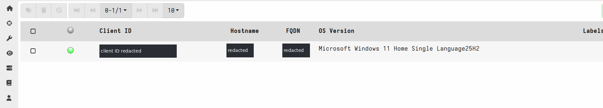
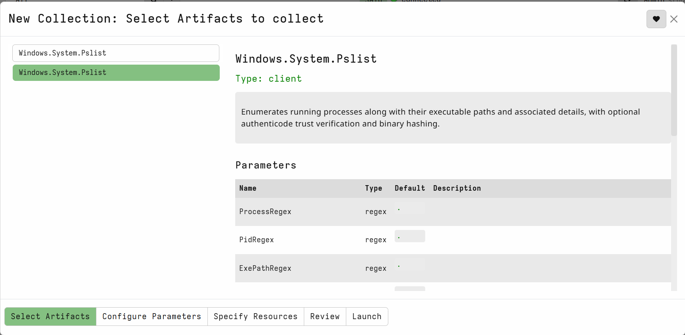
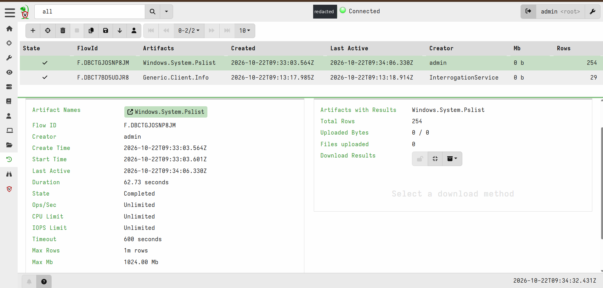
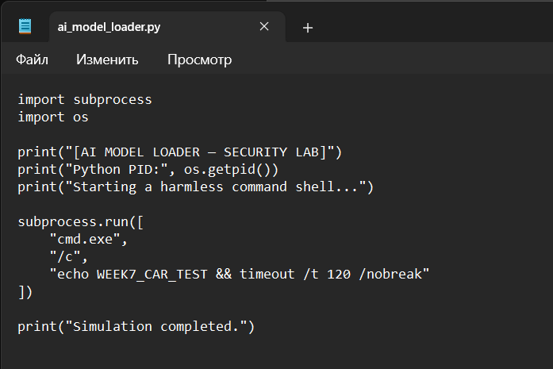
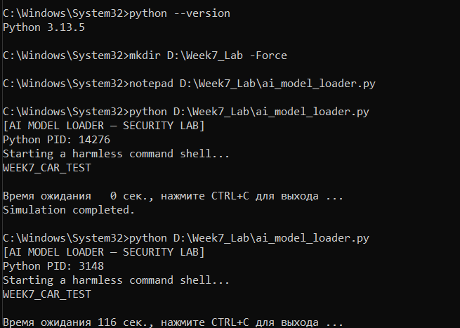
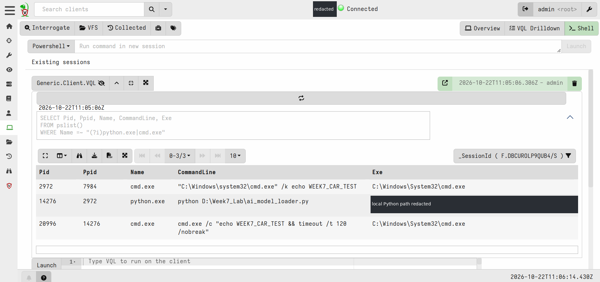
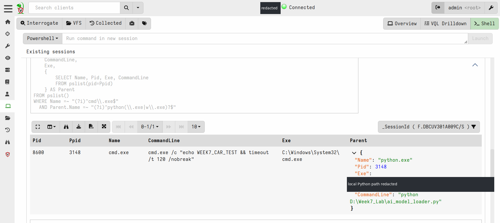
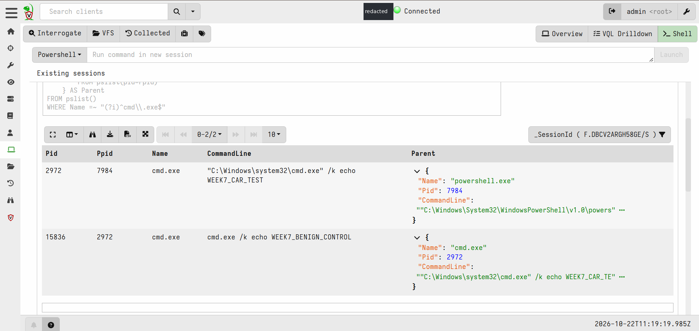
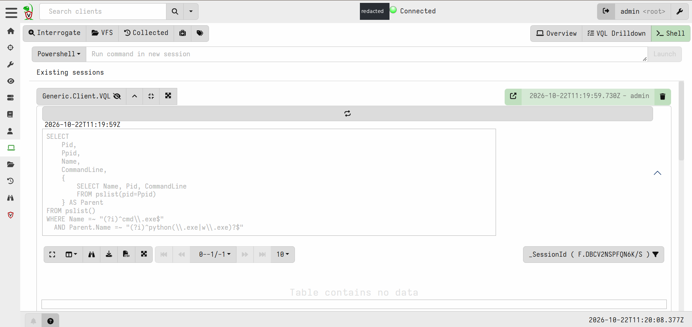

# Week 7 — MITRE CAR: Python-to-cmd Detection

**AI Supply Chain Threat Intelligence**  
Project: Detection and Threat Intelligence Analysis of AI Supply Chain Threats Using MITRE ATLAS  
Course: Introduction to Threat Hunting · Astana IT University · 2026–2027  
Practical execution: **22 October 2026** · Windows 11 · Velociraptor **0.77.3** · Python **3.13.5**

> **Result:** the live-process query returned a cmd.exe child of Python in the positive lab test. A separate non-Python control was visible to a broad query, but no matching row was displayed by the Python-parent filter. These are controlled observations, not a malware verdict or a detection-rate measurement.

[Experiment](#3-experiment-and-evidence) · [VQL](#4-the-recorded-vql-rule) · [Results](#5-results-and-interpretation) · [Mapping](#6-mitre-mapping) · [Reproduce](docs/reproduce.md) · [Evidence](evidence/README.md) · [Sources](docs/sources.md)

## 1. Objective and course requirement

The task is to select an analytic from MITRE CAR, implement it in a SIEM, and map it to ATT&CK. The supplied assignment is preserved as [E00](images/00_assignment.png).

We selected **CAR-2013-02-003 — Processes Spawning cmd.exe** and adapted its parent-process analysis to a local Windows lab. The original CAR entry is broader: its pseudocode selects cmd process-creation records; it does not contain our Python-only filter. [S01](docs/sources.md#s01)

**Scope boundary:** this run implements the adaptation in **Velociraptor**, an endpoint investigation platform, not a SIEM. No Week 7 SIEM execution or instructor approval for that substitution was provided. The report documents the work completed; it does not claim the SIEM requirement has been satisfied. [S09](docs/sources.md#s09)

| Task element | Recorded outcome |
|---|---|
| Select a CAR analytic | CAR-2013-02-003 selected and explained |
| Implement and test an analytic | VQL executed on a Windows endpoint; positive and negative scenarios captured |
| Implement specifically in a SIEM | **Not demonstrated** in the supplied Week 7 material |
| Map to ATT&CK | Primary T1059.003; Python T1059.006 as supporting context |


## 2. Environment and evidence

The local Windows client and Velociraptor's GUI mode was used. The first attempt could not bind the frontend to port 8000; the submitted terminal output identified a local Splunk process using that port. After Splunk was stopped with its normal CLI command and Velociraptor was restarted, the client appeared. The relevant failed-start excerpt is [preserved separately](evidence/startup_excerpt_redacted.txt).


*Figure 1 — E01. The local client is connected. Personal identifiers are redacted in the publication copy.*

The baseline `Windows.System.Pslist` collection completed with **254 rows** in **62.73 seconds**. These rows describe running processes; they are not 254 suspicious events or a history of all process starts. [E03](images/03_pslist_completed.png), [S04–S05](docs/sources.md#s04)

<details>
<summary>View baseline collection setup and completion</summary>


*E02. Selected artifact and its visible default filters.*


*E03. Completed collection, 254 rows, duration 62.73 seconds.*

</details>

The report uses screenshots and code from the conversation. Native Velociraptor result exports were **not supplied**. The CSV files in this folder are clearly labelled screenshot transcriptions, not new telemetry. See the [evidence register](evidence/README.md) and [image manifest](evidence/screenshots_manifest.csv).

## 3. Experiment and evidence

### A. Safe execution stimulus

The student ran this script locally:

```python
import subprocess
import os

print("[AI MODEL LOADER — SECURITY LAB]")
print("Python PID:", os.getpid())
print("Starting a harmless command shell...")

subprocess.run([
    "cmd.exe",
    "/c",
    "echo WEEK7_CAR_TEST && timeout /t 120 /nobreak"
])

print("Simulation completed.")
```

The source is saved in [`simulation/ai_model_loader.py`](simulation/ai_model_loader.py), transcribed from [E04](images/04_simulation_source.png). The command prints a test marker and waits. Python waits for the child command to complete. This gives a live-process query an opportunity to observe both processes. [S10–S12](docs/sources.md#s10)

There is no reverse shell, network payload, credential access, model download, or deletion in this script. The marker is not a threat indicator.

<details>
<summary>View the source and terminal evidence</summary>


*E04. Source displayed by the student.*


*E05. Python 3.13.5 and two test launches. The earlier PID and the later PID belong to different runs.*

</details>

### B. Discover the process chain

An exploratory VQL query displayed Python and cmd together. Its result contained:

```text
cmd.exe       PID 2972
└── python.exe  PID 14276, PPID 2972
    └── cmd.exe  PID 20996, PPID 14276
```


*Figure 2 — E06. The child cmd's PPID matches the Python PID. The personal Python installation path is redacted; the lab script path is retained.*

This result establishes visibility of the test processes. Simply listing both names is not enough; the PID/PPID relationship is the important observation. `echo` is a shell command, not a separately observed child process in this table.

### C. Positive detection

After another launch, the parent-filtered query returned this row:

| Child | Child PID | Child PPID | Resolved parent | Parent PID |
|---|---:|---:|---|---:|
| cmd.exe | 8600 | 3148 | python.exe | 3148 |


*Figure 3 — E07. The returned Parent object shows Python and the lab script. The different PIDs from Figure 2 are expected: this is a later run.*

### D. Negative control

The student then ran the following inside an already open **cmd** window:

```cmd
cmd.exe /k echo WEEK7_BENIGN_CONTROL
```

The broad parent-context query returned two cmd rows. Their actual relationship was:

```text
powershell.exe  PID 7984
└── cmd.exe      PID 2972, PPID 7984
    └── cmd.exe  PID 15836, PPID 2972
        CommandLine: cmd.exe /k echo WEEK7_BENIGN_CONTROL
```


*Figure 4 — E09. The labelled control's immediate parent is cmd.exe, not PowerShell. The control command itself is shown in [E08](images/08_negative_command.png).*

The narrower Python-parent query then displayed **`Table contains no data`**.


*Figure 5 — E10. The filter did not display the non-Python control. The UI pagination placeholder is not treated as a verified export count.*

## 4. The recorded VQL rule

Run this in the **selected client → Shell → VQL**, not in PowerShell. The GUI sends these queries through `Generic.Client.VQL`. [S08](docs/sources.md#s08)

```sql
SELECT
    Pid,
    Ppid,
    Name,
    CommandLine,
    Exe,
    {
        SELECT Name, Pid, Exe, CommandLine
        FROM pslist(pid=Ppid)
    } AS Parent
FROM pslist()
WHERE Name =~ "(?i)^cmd\\.exe$"
  AND Parent.Name =~ "(?i)^python(\\.exe|w\\.exe)?$"
```

The outer query selects a live cmd process. The nested query uses that row's `Ppid` to look up its parent. The final condition retains Python parents. VQL supports this column-subquery pattern; the screenshot supplies execution evidence for this particular query. [S04](docs/sources.md#s04), [S06](docs/sources.md#s06)

The positive test used the complete query above. The negative test used the **same filter** but omitted the two `Exe` output columns. Both versions are saved separately, so the report does not silently replace the executed queries with a new version.

The historical pattern also accepts `pythonw.exe` and bare `python`; only `python.exe` was exercised. The query does not check the marker text, file signatures, model activity, or intent. [Query notes](queries/README.md)

## 5. Results and interpretation

| Check | Observed result | What it supports |
|---|---|---|
| Baseline collection | 254 rows; Completed | Endpoint collection succeeded |
| Discovery query | Three visible process rows | The test chain was observable |
| Positive Python-parent filter | One visible cmd row | The rule matched the intended procedure |
| Negative broad context | Two visible cmd rows | The non-Python control existed |
| Negative Python-parent filter | No matching rows displayed | The control did not meet the Python-parent condition |

These are **functional checks**, not a representative evaluation dataset. Both procedures were authorised and harmless. A legitimate Python automation script can produce the same parent-child relationship and match this rule. We therefore do not report precision, recall, false-positive rate, or “100% detection”.

The broad CAR-style query should still include ordinary cmd activity. The negative result validates our **Python-only refinement**, not an ability to decide whether every command shell is safe.

Structured summaries: [`observed_results.csv`](data/observed_results.csv) and [`process_rows_transcribed.csv`](data/process_rows_transcribed.csv).

## 6. MITRE mapping

| Item | Role | Evidence boundary |
|---|---|---|
| **CAR-2013-02-003** | Source analytic | Adapted to live snapshots and Python-parent filtering |
| **TA0002 — Execution** | Tactic context | Controlled lab code execution |
| **T1059.003 — Windows Command Shell** | Primary technique | cmd invocation and returned child-process row |
| **T1059.006 — Python** | Supporting context | Python parent executes the lab script; not a separate broad detector |

The mapping describes the emulated behaviour, not an observed attacker or a real supply-chain breach. [Official references](docs/sources.md#s02), [detailed rationale](docs/mitre_mapping.md), [mapping CSV](data/mitre_mapping.csv).

## 7. Limitations and next work

**Snapshot limitation.** The query looks at processes that still exist. The 120-second wait makes this test easier to observe; a short-lived cmd can be missed. Parent lookup is not an atomic process-creation record, and this version does not validate creation times against PID reuse.

**Narrow coverage.** It looks only for the selected interpreter names directly parenting cmd. It does not inspect model weights, recognise a red-X trigger, detect arbitrary Python abuse, or cover all possible shell-launch chains.

**Evidence limitation.** No native process export, continuous monitoring record, alert history, or larger benign/malicious corpus was supplied. An empty UI alone is insufficient; here it is paired with a separate control-existence capture.

**Platform requirement.** This is a Velociraptor endpoint implementation. A SIEM run remains outside the recorded work. Future event-based collection, an expanded test set, or a SIEM implementation would need new evidence and must not be labelled as already completed.

## 8. Repository contents and repeatability

```text
week7/
├── README.md
├── queries/           # The executed query variants and notes
├── simulation/        # Harmless Python source and manual control command
├── data/              # Screenshot-derived results and mapping tables
├── images/            # Student captures; publication redactions where needed
├── evidence/          # Provenance, environment, checksums, packaging QA
├── docs/              # Sources, mapping, reproduction, Russian defence/upload help
└── tools/             # Local package validation; not an endpoint/VQL re-run
```

To repeat the Windows test, use [the reproduction guide](docs/reproduce.md).
To check the packaged files without running the simulation:

```bash
python week7/tools/validate_package.py
```

The recorded Windows experiment was performed by the student. During packaging,
only the file structure, Python syntax, screenshot-derived consistency, local
links and hashes were checked; no fresh Windows/VQL execution is claimed.
See [`validation_report.txt`](evidence/validation_report.txt).

**AI assistance:** AI helped with the original query drafts, troubleshooting,
source checks, captions, documentation, and packaging. The student ran the local
Windows tests and supplied screenshots. Interpretations and reference checks
added during packaging are separated from the observed results. No generated UI
image or fabricated live event is presented as evidence.

For public GitHub, use the supplied redacted images. Do not publish Velociraptor
configs, private keys, or the full datastore. See [upload instructions in Russian](docs/github_upload_ru.md).
